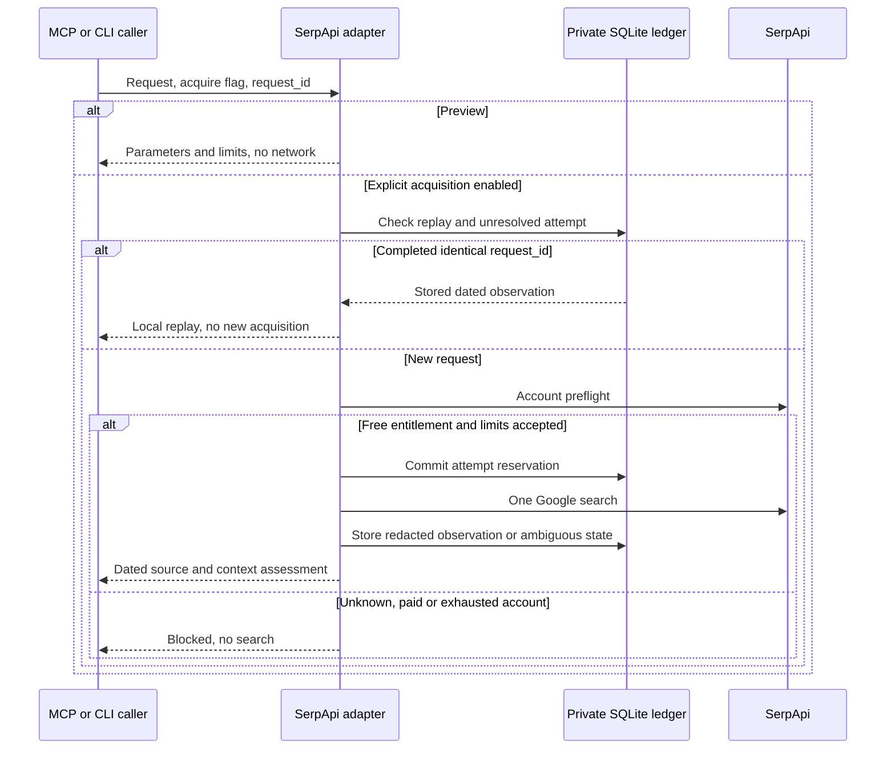

# Experimental SerpApi integration and free-account setup

This source branch implements the experimental adapter for issue #95 with two MCP tools and matching CLI commands. On 11 October 2026, the current Codex session acquired two public Google SERPs, one desktop and one mobile, and replayed the desktop observation locally without network calls. These cases establish limited live operation, not a package release, general provider qualification or diagnostic quality improvement. All automated provider tests use synthetic responses. No real search, signup, purchase or account change was performed during the initial preparation.

## Free plan and local ceilings

Checked on 11 October 2026: [SerpApi pricing](https://serpapi.com/pricing) lists 250 searches per month and 50 per hour. Its [official FAQ](https://serpapi.com/blog/google-maps-scraper/) states that the free plan requires no credit card. A subsequent private account preflight verified an active zero-price free account. Two successful desktop/mobile outputs were checked in the current-session follow-up in the linked validation report.

The adapter checks the [Account API](https://serpapi.com/account-api) before each new search. This endpoint is documented as free and outside the monthly search quota. The account response must explicitly show an active `Free` or `Free Plan`, numeric monthly price 0, 1–250 monthly searches, no extra credits, available plan/total searches and a positive integer hourly ceiling. The advertised hourly rate is not a hard upper bound for account entitlement: a free account can report a higher rate. The independent local ceiling stays at 50 attempts per hour regardless of that value. Missing, paid or unexpected entitlement fields stop the call before search dispatch. The adapter does not purchase credits, change plans or contact another provider.

Default local limits are 40 search attempts over a rolling 31-day window and 50 over a rolling hour. These conservative windows differ from the provider's billing period. Each search attempt is reserved durably before dispatch. Failed and uncertain attempts are never refunded automatically, even when the provider may not charge them. Account hourly counters are added conservatively, which may refuse earlier than the provider. Account status is checked before dispatch; changes made by other consumers after this check are outside our control.

| Environment setting | Default | Meaning |
|---|---|---|
| `SERPAPI_API_KEY` | Absent | Private credential; never supplied as a tool argument |
| `GSC_SERPAPI_ENABLED` | Absent | Only the exact value `1` permits explicit acquisition |
| `GSC_SERPAPI_MONTHLY_LIMIT` | `40` | Local rolling 31-day attempt ceiling, 1–250 |
| `GSC_SERPAPI_HOURLY_LIMIT` | `50` | Local rolling-hour attempt ceiling, 1–50 |
| `GSC_SERPAPI_STORE_DIR` | `platformdirs.user_data_dir('gsc-mcp')/serpapi` | Absolute private directory shared by this user's clients |
| `GSC_MCP_TOOL_FAMILIES` | Existing full catalogue | Include `serp` when using an allowlist; `core` remains included |

Preview and discovery do not call the provider or initialize storage. Declaring a key does not authenticate the account. `runtime_qualified: false` in capabilities describes this experimental adapter's release qualification, not the current connection's authentication state.

The local ledger is shared per credential fingerprint and store directory. Clients using other stores, a rotated key or other machines are not jointly counted by that ledger; the account preflight sees provider counters, but cannot atomically coordinate unrelated clients. Use one key/store for this pilot and keep the account free. Do not reset the ledger to bypass limits. The default 40 attempts do not authorize using private GSC queries with a new provider.

## Connect an account without a card

1. Open [SerpApi registration](https://serpapi.com/users/sign_up), create your own account and complete the required verification. Select the free plan. The published offer does not require a card; do not select a paid upgrade or extra credits.
2. Retrieve the key from [Your API Key](https://serpapi.com/manage-api-key). Keep it in your private secret store or local MCP client configuration, outside this chat and the repository.
3. Supply `SERPAPI_API_KEY` to the process running this source branch. Set `GSC_SERPAPI_ENABLED=1`; retain the default monthly limit of 40 or lower it. If using family selection, add `serp` to the current family list rather than replacing other needed families.
4. Restart that MCP process and call `get_capabilities`. This only checks declarations and discovery. Run `serpapi_search` without `acquire` to inspect a request offline. It does not verify the key.
5. For the first separately supervised real test, request a public, non-strategic query with `acquire=true` and a unique `request_id`. The tool verifies the free account and then makes one search request. A response from our synthetic tests is not a substitute for this qualification.

A source checkout is required until this change is released. The already installed PyPI version does not gain these commands merely because the local files exist. From the isolated checkout, use the project's development environment and `python -m gsc_mcp.cli` or `python -m gsc_mcp.server` with that checkout's `src` on `PYTHONPATH`.

Example configuration fields to add to the existing private server environment, with the key value coming from your secret store:

```text
SERPAPI_API_KEY=<private value supplied locally>
GSC_SERPAPI_ENABLED=1
GSC_SERPAPI_MONTHLY_LIMIT=40
GSC_SERPAPI_HOURLY_LIMIT=50
```

The initial preparation wrote no global configuration or account credential. During the connection follow-up, the user supplied the credential privately and the existing Codex server launcher was switched to the isolated source environment. Remove credential fields from an export before supplying it to a chat or tool: output redaction cannot erase the original input transcript.

## Tools and capture behavior

`serpapi_search(query, country='fr', language='fr', device='desktop', location='', fresh=False, acquire=False, request_id='')` defaults to preview. Only desktop and mobile are supported initially. The exact query is preserved, including Unicode, plus signs and literal percent sequences. Country and language configure Google search context; they do not establish the language of the query text.

With explicit acquisition, the adapter uses fixed HTTPS endpoints with a 30-second timeout, no redirects, proxy environment, retry, pagination or enrichment. It requests Google.com with offset 0. The number of organic items is whatever the producer delivers; the adapter does not promise ten organic results or fetch missing features. Response body limit is 1 MiB; account body limit is 16 KiB. No source link, pagination link or producer text is executed.



The diagram describes the implemented dispatch order, tested with synthetic transport and exercised by the two live session cases. Other producer deliveries and interrupted live requests remain unqualified.

`serpapi_import_preview(report_json, query, ...)` parses caller-supplied JSON offline with the same size, identity and missing-data rules. It does not save a snapshot or establish source authenticity. Receipt time is unavailable. The source hash covers the caller's original JSON bytes; the exposed producer body has credential fields and echoed key values redacted. Hashing does not authenticate a producer.

For a capture, `source_sha256` covers the original response bytes before redaction. The local ledger stores the redacted producer structure, requested/effective parameters, source hash, provider dates/ID and receipt date. It never stores the original secret-bearing body. Unknown feature sections and reported organic positions remain present. Missing organic results remain `null`; an explicit empty list stays an observed empty list. A changed country, query, language, domain, engine, device or requested location yields `mismatch`; absent required identity/date/ID yields `partial`.

There are no clicks, impressions, search volumes or GSC average positions invented from SERP ranks. Schema/context `success` means this adapter accepted the supplied response, not a successful SEO action or an independently verified Google ranking.

## Cache, storage and interrupted attempts

[SerpApi's Google contract](https://serpapi.com/search-api) documents exact-parameter caching for one hour, with cached searches excluded from monthly charges. `fresh=true` sends `no_cache=true`; the output records `bypass_requested`. Otherwise the adapter reports provider cache origin as `unknown`, rather than deriving it from a successful response or timestamps alone.

Repeating an identical completed `request_id` replays the local observation, preserving its original dates and source hash. `delivery=local_replay` and `network_calls=0` describe that delivery, not the provider's cache. There is no automatic cache refresh or age-based re-acquisition. A different context with the same identifier is rejected.

A timeout, oversized/invalid response, HTTP failure after reservation, processing status or interrupted process leaves an unresolved attempt. All new acquisitions using that key/store stop, including attempts with a new ID. Keep the ledger and reconcile the request with the provider before designing an explicit reviewed recovery. This first version intentionally exposes no reset, retry or deletion tool. A definite provider error is retained as `provider_error`, without automatic retry. Actual billed cost remains `null`; a zero-price preflight is not a bill.

Storage uses a private directory (0700) and SQLite file (0600), refuses symlink stores/database files and commits reservations across client restarts. Maximum retained result payload is 32 MiB and maximum records is 1000; storage exhaustion stops new captures. The store has no automatic expiry or export. Windows ownership/permission behavior is not qualified by the macOS tests.

SerpApi is excluded from the existing bounded audit acquisition allowlist and refuses direct acquisition while that audit context is active. Its account/search transport does not participate in the older Google/Bing audit budget; adding it there requires a separate contract.

## Validation and remaining evidence

Automated tests cover free-plan refusal, missing entitlement fields, shared provider quota exhaustion, durable rolling limits, replay and conflicts, exact query encoding, concurrent clients, process interruption, HTTP 200 provider errors, context changes, absent fields, redaction, oversized bodies, redirect refusal and offline MCP/CLI discovery. Fixtures use reserved test domains and synthetic queries; no private GSC result is embedded.

The live pilot verified two Google desktop/mobile deliveries, echoed France/language/device parameters, provider timestamps and local replay. It did not request a location or establish provider cache origin. Broader queries, explicit location, fresh requests, provider cache behavior and independent Google verification remain to be qualified before advertising general live support. Before claiming quality improvement, compare diagnostics with and without the new observations against independent human annotations. Agreement with DataForSEO alone is not ground truth. This task does not build a DataForSEO adapter or perform a live supplier comparison.

Local validation results are recorded in [the preparation validation](validation/2026-10-11-serpapi-preparation.md).
